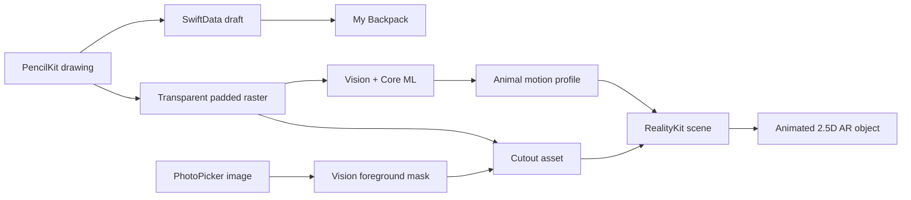

<div align="center">
  

  <h1>AniMagic</h1>

  <p>Turn hand-drawn animal doodles into animated augmented-reality companions.</p>

  <p>
    
    
    
    
  </p>

  <p>
    <a href="#getting-started">Get started</a> ·
    <a href="#features">Features</a> ·
    <a href="#architecture">Architecture</a> ·
    <a href="#development">Development</a> ·
    <a href="#documentation">Documentation</a>
  </p>
</div>

AniMagic is an iOS and iPadOS SwiftUI application that turns a PencilKit drawing into a locally classified, animated AR object. Draw an animal, let Vision and Core ML recognize it on-device, then place the resulting transparent cutout on a real surface or explore it inside a virtual room.

> [!NOTE]
> Doodle classification runs locally on the device. AniMagic does not need a network connection to recognize drawings.

## Features

- **Draw with PencilKit** — Apple Pencil and touch input, the system tool picker, undo/redo, drawing guides, editable names, and draft autosave.
- **Classify on-device** — Vision and the bundled `AnimalSpeciesClassifierV4.mlpackage` produce an animal label and confidence without uploading the drawing.
- **Create animated cutouts** — Transparent raster artwork becomes a deformable 2.5D cardboard-style object with front/back surfaces, a procedural rim, soft shadows, and Metal-driven motion.
- **Place objects in AR** — Detect horizontal surfaces, place doodles or bundled USDZ props, select and delete objects, choose plane or camera-roam spawning, and respond to taps and proximity.
- **Organize a My Backpack library** — Persist drawings and cutouts with SwiftData, search and filter artwork, share drawings, edit names, correct classifications, and retry failed classification jobs.
- **Explore a Virtual Room** — Switch between Explore and Edit modes, choose Citrus Orchard, Land, or Underwater environments, and populate the scene with doodles and static 3D props.
- **Build a Cutout Library** — Select photos with `PhotosPicker`, extract foreground objects with Vision, and reuse the resulting cutouts in AR.

## How it works



The AR render keeps the original transparent, padded image so its alpha channel can drive visible bounds, contours, holes, and cardboard geometry. Classification uses a separate normalized 64×64 grayscale, inverted image so the model receives a consistent input.

## Technology

| Area | Implementation |
| --- | --- |
| UI and state | SwiftUI, Observation, `@MainActor` isolation |
| Drawing | PencilKit |
| Classification | Vision, Core ML, Core Image |
| AR and rendering | ARKit, RealityKit, Metal |
| Persistence | SwiftData |
| Motion and sensors | GameplayKit, Core Motion |
| Audio and feedback | AVFoundation, Core Haptics, UIKit feedback generators |
| Project generation | XcodeGen |

## Requirements

- macOS with **Xcode 16 or newer**
- iOS/iPadOS **18.0 or newer**
- A physical ARKit-compatible iPhone or iPad for camera tracking, surface detection, and AR placement
- An iPad with Apple Pencil for testing PencilKit input and palm rejection
- An Apple Developer team when running on a physical device
- XcodeGen only when changing `project.yml` or regenerating the committed project

The iOS Simulator can build and exercise non-camera screens, but it cannot fully validate AR tracking, camera permission behavior, scene reconstruction, or Apple Pencil interaction.

## Getting started

1. Clone the repository:

   ```bash
   git clone https://github.com/dimaswisodewo/Animagic.git
   cd Animagic
   ```

2. Open the committed Xcode project:

   ```bash
   open AniMagic.xcodeproj
   ```

3. Select the **AniMagic** scheme.
4. Choose an iOS 18+ simulator or a supported physical device.
5. For a physical device, select your Apple Developer team under **Signing & Capabilities**.
6. Build and run.

The Core ML model, fonts, audio, image resources, virtual-room assets, and current USDZ props are included in the repository.

## Architecture

Application composition and navigation are centralized in `Animagic/App`. `AppRoute` and `NavigationRouter` own pushes, sheets, full-screen covers, and dismissals so features do not introduce independent navigation state.

| Layer | Responsibility | Representative types |
| --- | --- | --- |
| App | Composition, routing, shared session state | `AnimagicApp`, `AppRoute`, `NavigationRouter` |
| Features | User-facing screens and feature-specific coordination | `CanvasPageView`, `BackpackPageView`, `NewARPlacementView`, `VirtualRoomView` |
| Image processing | Rasterization, classification, foreground extraction | `DrawingRasterizer`, `DoodleClassificationCoordinator`, `VisionForegroundCutoutProcessor` |
| Persistence | SwiftData records and repository-backed library state | `SavedDrawingRecord`, `CutoutAssetRecord`, `ArtworkLibraryStore` |
| Rendering | Cutout meshes, contours, rims, materials, and shadows | `CutoutEntityFactory`, `CardboardRimMeshGenerator`, `CutoutDeformation.metal` |
| Shared UI | Design tokens and reusable controls | `AnimagicDesignSystem`, `ColorToken`, shared UI components |

Artwork persistence is local. `SavedDrawingRecord` stores the editable PencilKit drawing and metadata, while `CutoutAssetRecord` stores the rendered image, source drawing relationship, classification result or error, and optional manual label override.

## Project structure

```text
Animagic/
├── App/                    # App composition, routing, and session state
├── Core/
│   ├── Audio/              # Music, sound effects, and audio sessions
│   ├── ImageProcessing/    # Rasterization, Vision, Core ML, and cutouts
│   ├── Models/             # Domain models and artwork categories
│   ├── Persistence/        # SwiftData records and repositories
│   ├── Rendering/          # RealityKit, procedural geometry, and Metal
│   └── Stores/             # Artwork library orchestration
├── Features/
│   ├── ARPlacement/        # AR session, interaction, placement, and motion
│   ├── Backpack/           # Saved artwork library
│   ├── Canvas/             # PencilKit drawing experience
│   ├── CutoutLibrary/      # Photo foreground extraction
│   ├── Home/               # App home screen and entry points
│   └── VirtualRoom/        # Explore/edit environments and 3D props
├── Resources/              # Core ML, fonts, audio, images, and USDZ assets
└── Shared/                 # Design system and reusable UI

AnimagicTests/              # Focused XCTest source files
docs/                       # Architecture and asset-pipeline documentation
scripts/                    # Project utilities and AR asset tooling
project.yml                 # XcodeGen specification
```

## Model and AR assets

The bundled classifier is stored at:

```text
Animagic/Resources/Models/AnimalSpeciesClassifierV4.mlpackage
```

Xcode compiles the package into `AnimalSpeciesClassifierV4.mlmodelc` at build time. Runtime loading is implemented in `Animagic/Core/ImageProcessing/DoodleClassification.swift`. Unknown or failed classifications remain usable through generic cutout behavior, while manual labels can override the motion profile without replacing the original prediction metadata.

Static Blender-derived props follow the repository's AR asset pipeline. The pipeline preserves artist source files, optimizes mobile geometry and textures, packages explicit USD dependencies, runs `usdchecker`, and produces an Apple Metal validation render.

> [!IMPORTANT]
> Never overwrite an artist's source `.blend` file or accept a USDZ based only on successful export. Structural dependency checks and an Apple Metal render are required.

For the guided workflow:

```bash
./scripts/ar-asset
```

For automation:

```bash
./scripts/ar-asset build /path/to/Asset.blend
./scripts/ar-asset approve build/asset-pipeline/Asset
```

See the [AR asset pipeline](docs/asset-pipeline/README.md) and the [script operator guide](scripts/README.md) for prerequisites, output artifacts, validation gates, and troubleshooting.

## Development

### Regenerate the Xcode project

The committed `AniMagic.xcodeproj` is generated from `project.yml`.

```bash
brew install xcodegen
./generate-project.sh --check
./generate-project.sh
```

Commit `project.yml` and the regenerated `AniMagic.xcodeproj` together.

### Build from the command line

```bash
xcodebuild \
  -project AniMagic.xcodeproj \
  -scheme AniMagic \
  -configuration Debug \
  -destination 'generic/platform=iOS Simulator' \
  CODE_SIGNING_ALLOWED=NO \
  build
```

### Host-side asset tests

```bash
python3 -m unittest discover -s scripts/asset-pipeline/tests -v
```

Set `ANIMAGIC_RUN_BLENDER_INTEGRATION=1` to include the Blender-to-Metal integration smoke test when all required macOS tools are installed.

The repository contains focused XCTest sources under `AnimagicTests`, but the current generated Xcode project defines only the `AniMagic` application target. Wire a dedicated test target before relying on those files through `xcodebuild test`.

## Permissions and troubleshooting

AniMagic uses the following capabilities at runtime:

- **Camera** for AR world tracking and placement.
- **Photo Library Add** for saving artwork to Photos.
- **Microphone** is declared for camera video capture flows.

If camera access is denied, enable it from **Settings → Privacy & Security → Camera → AniMagic**.

### The Core ML model cannot be loaded

- Confirm `Animagic/Resources/Models/AnimalSpeciesClassifierV4.mlpackage` exists.
- Confirm the resource is included in the **AniMagic** target.
- Clean the build folder and rebuild so Xcode recompiles the model.

### AR cannot find a surface

- Use a physical ARKit-compatible device.
- Grant camera access.
- Move the device slowly in a well-lit area with visible surface detail.
- Wait for the tracking status to become ready before placing an object.

### The generated project is out of date

Run `./generate-project.sh --check`. If it fails, run `./generate-project.sh`, then review both `project.yml` and `AniMagic.xcodeproj/project.pbxproj`.

### Xcode reports a capitalization mismatch

Preserve the repository's exact casing:

- Project: `AniMagic.xcodeproj`
- Source directory: `Animagic`

Do not rename one without updating `project.yml` and regenerating the project.

## Documentation

- [Hand Drawing to Animated AR](docs/HAND_DRAWING_TO_ANIMATED_AR.md) — the end-to-end PencilKit, Core ML, procedural cutout, motion, and AR pipeline.
- [ARKit & RealityKit Architecture Deep Dive](docs/ARKIT_REALITYKIT_DEEP_DIVE.md) — AR session lifecycle, raycasting, entity composition, interaction, Metal deformation, and motion simulation.
- [AR Asset Pipeline](docs/asset-pipeline/README.md) — source-of-truth rules for Blender-to-USDZ delivery.
- [Blender to USDZ](docs/asset-pipeline/BLENDER_TO_USDZ.md) — the scripted conversion workflow and mobile budgets.
- [USDZ Validation and Troubleshooting](docs/asset-pipeline/VALIDATION_AND_TROUBLESHOOTING.md) — structural, dependency, shader, geometry, and Metal-render checks.
- [AniMagic Scripts](scripts/README.md) — texture resizing and the `ar-asset` command reference.
