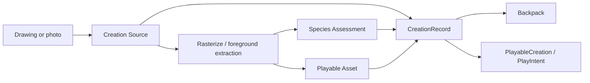

<!--
  ONBOARDING.md
  AniMagic

  Created by Meynabel Dimas Wisodewo on 20/07/26.
-->

# AniMagic Developer Onboarding Handbook

Welcome to AniMagic. This handbook is the starting point for engineers working
in the repository. Read **First day** and **How to make a safe change** before
your first pull request. The later sections are a reference for architecture,
specialist subsystems, and design decisions.

AniMagic is an iOS and iPadOS app that turns drawings and imported photos into
playable creations. Processing and classification happen on-device. A creation
can be kept in the Backpack and played with in augmented reality or the Virtual
Room.

## Contents

1. [First day](#first-day)
2. [Product and technology](#product-and-technology)
3. [Repository and target map](#repository-and-target-map)
4. [Architecture rules](#architecture-rules)
5. [Core data flows](#core-data-flows)
6. [Subsystem guide](#subsystem-guide)
7. [How to make a safe change](#how-to-make-a-safe-change)
8. [Testing and validation](#testing-and-validation)
9. [Debugging and troubleshooting](#debugging-and-troubleshooting)
10. [Reference and glossary](#reference-and-glossary)

## First day

### Prerequisites

- macOS with Xcode 16 or newer.
- An iOS 18 SDK and an iOS 18+ Simulator.
- XcodeGen when changing targets, resources, or build settings:

  ```sh
  brew install xcodegen
  ```

- A physical ARKit-compatible iPhone or iPad for camera tracking.
- An iPad and Apple Pencil for Pencil input and palm-rejection testing.
- An Apple Developer team for installing on physical devices.

The repository includes its Core ML model, fonts, audio, images, skyboxes, and
USDZ resources. There is no package bootstrap or remote service configuration.

### Clone and protect the main branch

```sh
git clone https://github.com/dimaswisodewo/Animagic.git
cd Animagic
git config core.hooksPath .githooks
chmod +x .githooks/pre-commit .githooks/pre-push
```

The tracked hooks prevent direct commits and pushes to `main`. Do development
on a topic branch. Remote branch protection remains authoritative.

### Open and run

The committed Xcode project is generated from `project.yml`:

```sh
./generate-project.sh --check
open AniMagic.xcodeproj
```

In Xcode:

1. Select the **AniMagic** scheme.
2. Choose an iOS 18+ Simulator for ordinary UI and unit-test work.
3. Choose a signed physical device for AR, camera, or Apple Pencil work.
4. Build with **Command-B**, test with **Command-U**, or run with **Command-R**.

Preserve the repository's capitalization: the project is
`AniMagic.xcodeproj`, while the source directory is `Animagic`.

### Command-line baseline

Build without signing:

```sh
xcodebuild \
  -project AniMagic.xcodeproj \
  -scheme AniMagic \
  -destination 'generic/platform=iOS' \
  -derivedDataPath /tmp/AnimagicDerivedData \
  CODE_SIGNING_ALLOWED=NO \
  build
```

List available test destinations:

```sh
DEVELOPER_DIR=/Applications/Xcode.app/Contents/Developer \
  xcrun simctl list devices available
```

Then run all three unit-test bundles using an available Simulator identifier:

```sh
xcodebuild test \
  -project AniMagic.xcodeproj \
  -scheme AniMagic \
  -destination 'platform=iOS Simulator,id=<SIMULATOR-UDID>' \
  -derivedDataPath /tmp/AnimagicTestDerivedData \
  CODE_SIGNING_ALLOWED=NO
```

The scheme runs `AniMagicTests`, `AniMagicCreationTests`, and
`AniMagicPlayTests`.

### First-day reading order

1. This handbook.
2. [`AGENTS.md`](../AGENTS.md) for mandatory repository rules.
3. [`CONTEXT-MAP.md`](../CONTEXT-MAP.md) for bounded-context ownership.
4. [`docs/architecture/README.md`](architecture/README.md) for the target graph.
5. The Creation and Play `CONTEXT.md` files linked by the context map.
6. Relevant architecture decision records under [`docs/adr`](adr/).

### A good first pull request

Choose a small change with no persistence or 3D-asset migration. Before asking
for review:

- reuse an existing design-system component;
- keep navigation in `AppRoute` and `NavigationRouter`;
- add or update a focused test where behavior changes;
- run `git diff --check`, the generic build, and relevant tests;
- manually inspect the affected screen;
- state any physical-device validation that remains outstanding.

## Product and technology

### Main user journeys

- Draw an animal with PencilKit, classify it, save it, and open it in Play.
- Import a photo, extract its foreground, and keep the resulting creation.
- Browse, rename, filter, share, retry, or delete creations in the Backpack.
- Place and animate creations and bundled props in AR.
- Explore creations in a non-AR Virtual Room.

### Technology map

| Concern | Technology |
| --- | --- |
| UI and state | SwiftUI, Observation |
| Drawing | PencilKit |
| Classification | Core ML, Vision |
| Image processing | Vision, Core Image, UIKit |
| Persistence | SwiftData |
| AR and 3D | ARKit, RealityKit, Metal |
| Motion | GameplayKit, Core Motion |
| Audio and haptics | AVFoundation, Core Haptics |
| Project generation | XcodeGen |
| Tests | XCTest |

The deployment target is iOS 18. App-owned code uses MainActor default
isolation. Treat UI state, SwiftData contexts, and RealityKit scene mutation as
actor-sensitive.

## Repository and target map

AniMagic is a modular monolith. It has framework boundaries for reusable domain
and infrastructure code while keeping application composition and existing UI
adapters in the app target.

```text
AniMagic app
├── AniMagicCreation
│   ├── AniMagicDesignSystem
│   └── AniMagicSupport
├── AniMagicPlay
│   ├── AniMagicCreation
│   ├── AniMagicDesignSystem
│   └── AniMagicSupport
├── AniMagicDesignSystem
└── AniMagicSupport
```

### Target responsibilities

| Target | Owns | Must not own |
| --- | --- | --- |
| `AniMagic` | app startup, dependency wiring, routing, Home, Help, cross-context handoffs | Creation or Play feature implementation |
| `AniMagicCreation` | canonical Creation model, repository contract, SwiftData record, catalog orchestration | app navigation or Play scene state |
| `AniMagicPlay` | environment-independent Play intent and session state | Creation persistence or app routes |
| `AniMagicSupport` | audio and haptic services | feature-specific presentation |
| `AniMagicDesignSystem` | extraction boundary for shared visual primitives | feature workflows |

`project.yml` is the source of truth. Never hand-edit the generated project to
make a durable target or membership change.

### Source layout

```text
Animagic/
├── App/                 # Entry point, composition, navigation, Home, Help
├── Modules/
│   ├── Creation/        # Creation domain, workflows, UI, persistence, resources
│   ├── Play/            # Play contracts, AR, Virtual Room, rendering, resources
│   ├── Support/         # Audio and haptics
│   └── DesignSystem/    # Reusable visual primitives and fonts
└── Resources/           # App-only assets
```

Feature UI and platform implementations are compiler-isolated in their owning
vertical framework. Module views emit semantic actions for the app router.

## Architecture rules

### Dependency direction

- Views render state and forward user actions.
- Observable models coordinate UI state and workflows.
- Services and managers perform focused side effects.
- Repositories abstract persistence and external data access.
- App composition creates concrete dependencies and injects them.
- Creation does not depend on Play.
- Play consumes creation identifiers or read-only playable values.
- Neither Creation nor Play imports app routing types.

Introduce a protocol when it creates a useful substitution boundary, such as
persistence or a side-effecting platform service. Do not create one-to-one
protocols for every concrete type.

### State and concurrency

- Prefer Observation's `@Observable` for new state models.
- Mark UI, ModelContext, and scene-coordination ownership with `@MainActor`.
- Make ownership explicit with `@State`, `@Environment`,
  `@EnvironmentObject`, or initializer injection.
- Do not perform business logic or side effects inside a SwiftUI `body`.
- Cancel or identify async work when a newer user action makes its result stale.
- Use `Sendable` value types across concurrency boundaries.

### Navigation

`AppRoute` and `NavigationRouter` are the only application navigation source of
truth. The app currently exposes routes for Canvas, Play, Backpack, creation
detail, the cutout library, Help, and the debug Motion Lab.

Play uses one route:

```swift
router.push(.play(PlayIntent(
    environment: .augmentedReality,
    initialCreationID: creationID
)))
```

`PlayEnvironment` selects augmented reality or Virtual Room. To add a
destination:

1. Add an `AppRoute` case with a minimal `Hashable` payload.
2. Map it in `AppRoute+Modifier.swift`.
3. Use `NavigationRouter` for push, replace, sheet, cover, dismiss, or back.

Do not add a second route enum, a private `NavigationStack`, or ad hoc Boolean
presentation state for an application destination.

### SwiftUI and design system

Before creating UI, inspect `Animagic/Modules/DesignSystem`.

- Extend an existing primitive when the visual behavior is broadly reusable.
- Keep feature-only components with their feature.
- Keep `body` concise by extracting meaningful sections.
- Preserve accessibility labels, Dynamic Type behavior, reduced-motion
  behavior, previews, and existing visuals during refactors.
- Avoid scattering colors, typography, radii, or motion values through feature
  views.

### File organization and authorship

- Put feature-specific code under the owning Creation or Play feature slice.
- Add shared code only to Design System or Support when it matches that target's narrow responsibility.
- Put application composition and routing under `Animagic/App`.
- Prefer one primary responsibility per file.
- Preserve existing source-file authorship.
- New Swift files require the configured Git author in the Xcode-style header.

## Core data flows

### Creation lifecycle



A `Creation` is the canonical user-owned item. It contains:

- a stable `CreationID`;
- a retained drawing, photo, or migrated legacy source;
- title and manual-title state;
- optional species prediction, correction, or failure;
- an optional derived `PlayableAsset`;
- a habitat derived from the effective species;
- creation date.

New code should use the language in
[`Modules/Creation/CONTEXT.md`](../Animagic/Modules/Creation/CONTEXT.md):
Creation, Creation Source, Playable Asset, Species Assessment, Habitat, and
Backpack.

### Persistence and migration

`CreationRecord` is the current SwiftData representation.
`CreationRepository` is the domain-facing persistence contract, and
`SwiftDataCreationRepository` is its concrete adapter.

`ArtworkMigrationPlan` provides a one-release bridge from the former
`SavedDrawingRecord` and `CutoutAssetRecord` schema:

- a drawing and its linked cutout become one Creation;
- an unlinked legacy cutout becomes a legacy-processed-image Creation;
- source and playable data are preserved;
- the former entities are removed only after the bridge stage.

`CreationLibraryStore` is the presentation-facing library API and delegates to
Creation-owned repository implementations. Former drawing and cutout record
names are private migration details; runtime features use Creation terminology.

If the persistent store cannot open or migrate, startup uses an in-memory
library and informs the user. The failed persistent store is not deleted or
overwritten.

Any schema change requires:

1. a new `VersionedSchema`;
2. an explicit migration stage;
3. migration tests using an on-disk old-schema fixture;
4. verification that no source or playable data is silently discarded.

### Play lifecycle

A `PlayIntent` contains a `PlayEnvironment` and optional initial creation
identifier. `PlaySessionModel` owns environment-independent selection and
pause/resume state.

Play sessions are ephemeral. The AR and Virtual Room implementations translate
shared intent into platform-specific scene behavior. Scene placements are not
Creation persistence.

Environment switching must preserve the selected creation. Play may request a
Creation workflow through the app, but it must not mutate Creation storage
directly.

## Subsystem guide

### Drawing, classification, and image processing

The drawing path uses PencilKit and `DrawingRasterizer`. Classification uses
Vision with the bundled `AnimalSpeciesClassifierV4.mlpackage`. Imported photos
use Vision foreground masks to produce transparent playable images.

Important invariants:

- preserve transparent padding needed by rendering;
- normalize classifier input separately from the playable image;
- reject empty drawings;
- protect against stale classification results;
- preserve manual names and species overrides;
- keep recoverable classification failures visible and retryable.

When replacing the Core ML model, preserve its resource name or update the
loader, verify target membership, retain the expected Vision classification
output, and test label-to-habitat and label-to-motion mappings.

### RealityKit, ARKit, and motion

The active AR implementation is `NewARPlacementView` and its
`NewARSceneController`. `CutoutSceneEditor` owns scene editing,
`CutoutEntityFactory` creates playable entities, and the interaction adapters
translate gestures and Apple Pencil input.

Keep these concerns separate:

- AR session lifecycle and tracking;
- raycasting or surface projection;
- object registry, selection, and editing;
- mesh and material creation;
- locomotion simulation;
- SwiftUI controls and feedback.

RealityKit entity changes belong on the MainActor. Update the dependency graph
before reading computed transforms after mutations. Validate tracking,
interactions, interruption recovery, and camera permissions on hardware.

### Virtual Room

Virtual Room is a Play environment, not an independent product domain. Its
coordinator owns non-AR scene and environment behavior. Shared Play concepts
must remain outside the environment adapter.

### Audio and haptics

Audio and haptic infrastructure lives in `AniMagicSupport`. The app composition
root owns service lifecycles and activates or deactivates them with scene phase.
Feature code requests behavior through the injected service rather than
constructing global engines.

### Resources and Blender-derived assets

App resources remain under `Animagic/Resources`. For Blender-derived USDZ work,
the asset pipeline is mandatory:

- [Pipeline overview](asset-pipeline/README.md)
- [Blender-to-USDZ runbook](asset-pipeline/BLENDER_TO_USDZ.md)
- [Validation and troubleshooting](asset-pipeline/VALIDATION_AND_TROUBLESHOOTING.md)

Never overwrite an artist's Blend. A successful export alone is not acceptance:
dependency checks and an Apple Metal validation render are required.

The guided repository command is:

```sh
./scripts/ar-asset
```

Run `./scripts/ar-asset doctor` before asset work and consult
[`scripts/README.md`](../scripts/README.md) for the full CLI contract.

## How to make a safe change

### Add or change a feature

1. Identify the owning bounded context and feature directory.
2. Reuse domain APIs and design-system primitives.
3. Put presentation in views and orchestration in an observable model.
4. Inject repositories and side-effecting services.
5. Route only through `NavigationRouter`.
6. Add focused tests for behavior and failure paths.
7. Validate the affected hardware path when applicable.

### Add a domain concept

Place Creation concepts in `AniMagicCreation` and Play concepts in
`AniMagicPlay`. Prefer immutable value types and minimal public interfaces.
Update the relevant `CONTEXT.md` when terminology or ownership changes. Add an
ADR when dependency direction, persistence ownership, or a cross-context
contract changes.

### Add persistence

Do not access `ModelContext` from a feature view. Extend the repository
contract, implement the SwiftData adapter, and test through the public behavior.
Treat migrations as product behavior, not setup code.

### Add a route

Extend `AppRoute`, update its central destination mapping, and pass a stable
identifier or intent instead of a mutable model graph. Update routing and
dependency wiring in the same change.

### Add a target or resource

Edit `project.yml`, then regenerate:

```sh
./generate-project.sh
./generate-project.sh --check
```

Commit `project.yml` and the generated `AniMagic.xcodeproj` changes together.
Do not fix generated-project drift by editing the `.pbxproj` directly.

### Refactor existing compatibility code

Move one behavior at a time behind the canonical module API. Keep the app
building and tests passing after each step. Delete the compatibility path only
after all consumers and persisted-data transitions are covered.

### Before review

```sh
git diff --check
./generate-project.sh --check
```

Also run the relevant build and tests, inspect the diff for accidental generated
or asset changes, and record manual validation. Do not claim AR, camera, Pencil,
or asset validation based solely on a Simulator build.

## Testing and validation

### Test ownership

- `AniMagicCreationTests`: Creation values and catalog/repository orchestration.
- `AniMagicPlayTests`: shared Play session behavior.
- `AniMagicTests`: app adapters, migration, rendering analysis, and motion.

Use Arrange–Act–Assert structure and typed fakes or spies. Test observable
behavior rather than implementation details.

### Minimum validation matrix

| Change | Unit tests | Simulator | Physical device |
| --- | --- | --- | --- |
| Domain or repository behavior | Required | Build | Not normally required |
| SwiftData schema or migration | Required with disk-backed fixture | Required | Recommended with existing user store |
| SwiftUI layout/navigation | Relevant tests | Required | Check when device behavior differs |
| PencilKit/Apple Pencil | Supporting logic | Partial | Required on iPad with Pencil |
| AR/camera/RealityKit interaction | Supporting logic | Build only | Required |
| Motion/rendering algorithm | Required | Useful | Required for visual acceptance |
| Audio/haptics | Supporting logic | Limited | Required |
| Blender/USDZ resource | Pipeline checks | Not sufficient | Apple Metal render and device review |

### Migration test expectations

Migration tests must open a real old-schema store, write representative records,
reopen it with the current migration plan, and verify identifiers, source data,
playable data, classification metadata, and orphan handling.

Core Data may log persistent-history truncation when legacy entities are
removed. The migration test result and preserved records determine success.

## Debugging and troubleshooting

### Generated project is stale

Run:

```sh
./generate-project.sh --check
./generate-project.sh
```

Review both the specification and generated project. If only the generated
project was edited, move the durable change into `project.yml`.

### Simulator cannot launch the test runner

A `Busy` or “failed preflight checks” error is usually Simulator state, not a
test assertion. Stop the running app, retry, or choose another available
Simulator. Separate build failures from launch failures in your report.

### Swift macros fail under a restricted shell

Observation or SwiftData macro errors mentioning a malformed plugin response or
`sandbox-exec` can be environmental. Re-run the same Xcode build in a normal
developer shell before changing source code.

### Persistent library cannot open

The app should display the recovery message and use a temporary in-memory
library. Do not delete the original store. Capture logs and reproduce with a
copy before changing the migration plan.

### Core ML model cannot load

- Confirm `Animagic/Resources/Models/AnimalSpeciesClassifierV4.mlpackage`.
- Confirm app target membership generated by `project.yml`.
- Confirm the loader uses the same resource name.
- Clean derived data after replacing the model.

### AR cannot find a surface

- Use a physical ARKit device.
- Confirm camera permission.
- Move slowly through a well-lit space with visible texture.
- Check tracking-state and placement-status feedback.
- Exercise interruption and retry behavior.

### A rendered cutout floats or contacts the floor incorrectly

Inspect alpha bounds, transparent padding, support-contact analysis, entity
origin, and applied transforms. Add a small synthetic-mask test before tuning
render-time constants.

### A UI change looks inconsistent

Search both Design System locations before adding local styling. Check Dynamic
Type, landscape layouts, accessibility labels, and Reduce Motion.

## Reference and glossary

### Canonical terms

| Term | Meaning |
| --- | --- |
| Creation | A user-owned item made from a drawing or photo |
| Creation Source | Retained drawing, original photo, or migrated legacy image |
| Playable Asset | Derived transparent representation consumed by Play |
| Species Assessment | Prediction, user override, or classification failure |
| Habitat | Land, skies, or underwater grouping |
| Backpack | User-facing collection of Creations |
| Play Session | Ephemeral interaction session |
| Play Environment | AR or Virtual Room spatial host |
| Placed Object | Scene instance of a creation or bundled prop |
| Environment Adapter | AR- or room-specific implementation of shared Play intent |

Avoid introducing the former terms “Artwork,” “Saved Drawing,” or “Cutout
Asset” in new domain APIs. They remain only in transitional compatibility code.

### Decision records

- [Vertical context frameworks](adr/0001-vertical-context-frameworks.md)
- [Unified Creation aggregate](adr/0002-unified-creation-aggregate.md)
- [Play environment adapters](adr/0003-play-environment-adapters.md)
- [One-release Creation migration](adr/0004-one-release-creation-migration.md)

### Where to ask a code question

Start from ownership:

- app lifecycle or routing → `Animagic/App`;
- Creation behavior or persistence contract → `AniMagicCreation`;
- shared Play state → `AniMagicPlay`;
- image processing → Creation; rendering and scene infrastructure → Play;
- screen-specific behavior → the owning module feature slice;
- audio or haptics → `AniMagicSupport`;
- colors, typography, or reusable controls → Design System.

If a change does not have a clear owner, resolve that architectural question
before adding code. Record durable boundary decisions in an ADR so the next
developer does not need to rediscover them.
